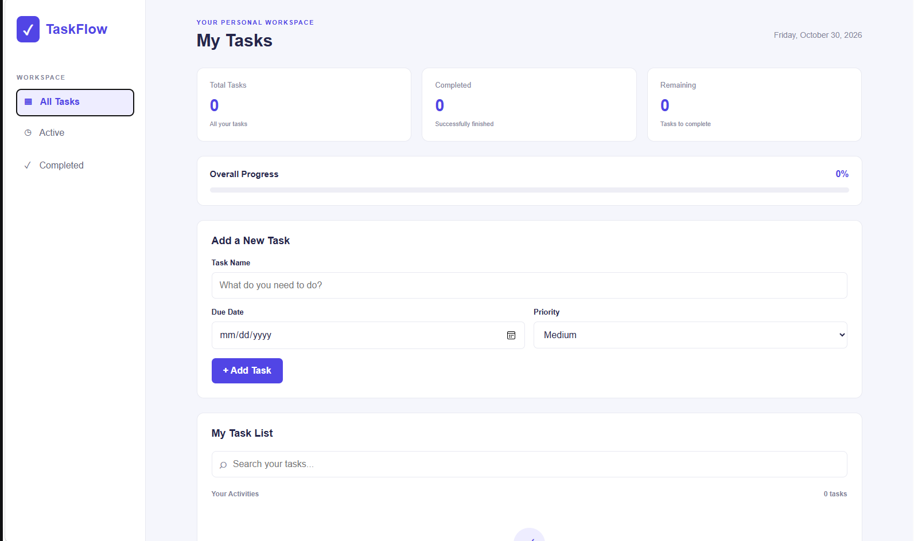
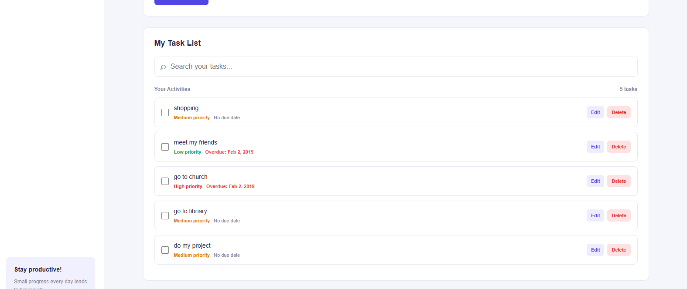

# 🚀 TaskFlow – Smart Task Manager

TaskFlow is a modern, responsive task management web application designed to help users organize daily activities, manage priorities, and track productivity.

## ✨ Features

- Add new tasks
- Edit existing tasks
- Delete individual tasks
- Mark tasks as completed
- Set task priorities (Low, Medium, High)
- Assign due dates to tasks
- Identify overdue tasks
- Search tasks by name
- Filter tasks (All, Active, Completed)
- View task statistics
- Track overall completion progress
- Clear all completed tasks
- Automatically save tasks using Local Storage
- Responsive design for desktop and mobile devices

## 🛠️ Technologies

- HTML5
- CSS3
- JavaScript
- Browser Local Storage

## 📂 Project Structure

todo-list-app/
├── index.html
├── css/
│   └── style.css
├── js/
│   └── script.js
├── screenshots/
└── README.md

## ⚙️ Installation

1. Clone this repository.
2. Open the project folder in Visual Studio Code.
3. Open index.html using your browser.
4. Start managing your tasks!

## 📸 Screenshots

### Dashboard

### Task Management

### Completed Tasks

## 🎯 Learning Outcomes

Through this project, I practiced:

- Semantic HTML and form handling
- Responsive CSS layouts
- JavaScript DOM manipulation
- JavaScript arrays and objects
- Event handling and event delegation
- Searching and filtering data
- Browser Local Storage
- Date handling and conditional logic
- Git and GitHub version control

## 👩‍💻 Author

**Netsanet Chafamo**

Computer Science Student

Interested in Web Development and Software Engineering.

---

Built with ❤️ using HTML, CSS and JavaScript.
